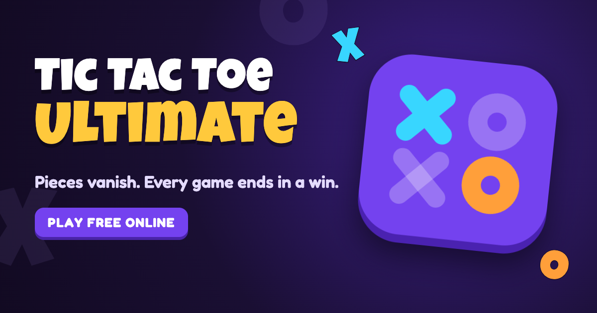

<p align="center"></p>

# Tic Tac Toe Ultimate

**Tic-tac-toe where pieces vanish, so every game ends in a win.** Each player keeps only three pieces on the board: place a fourth and your oldest disappears. It's fast, competitive and impossible to stall.

**Play:** https://tictactoeultimate.alidirect.dev · [How to play](https://tictactoeultimate.alidirect.dev/how-to-play/)

## Features

- **Ranked Arena:** lines shatter and deal damage to a health bar (125 HP), with combos, a red-alert ×2 finale, knockouts and overtime. A Glicko-2 ladder runs from Bronze to Master.
- **Casual** (sudden-death clock), **Old school** (classic, no vanishing), **Unlimited**, and **Daily** (one move a day, up to 10 games).
- **Pass & Play** on one device, fully offline, including Arena.
- **Bots** fill the queue when nobody's around: perfect play from a solved tablebase, with mistakes tuned so they win about 49% against each player. They show a BOT tag.
- **Accounts:** play as a guest instantly. Email sign-in carries your guest games, streak and quests over. Usernames, friends, chat, challenge links and live spectating.
- **Retention:** daily streaks with freezes, daily quests, history and move-by-move replays, and perfect-play analysis that marks blunders.
- **Polish:** Bert the ghost mascot (15 moods) plus X and O sidekicks, thrown emotes, impact frames, confetti, haptics, and dark and light themes.

## How it's built

| Part | Tech |
|---|---|
| Clients | Blazor WebAssembly (web) and .NET MAUI Blazor Hybrid (iOS, Android, Mac). One shared Razor UI library. |
| Game server | ASP.NET Core + SignalR. Authoritative matches, clocks with lag compensation, matchmaking, ratings. |
| Engine | `TicTacToeUltimate.Engine`: pure, deterministic rules, clocks, the Arena layer and a solved tablebase. |
| Bots | Go service (`bots/`): a rules port checked against the shared vectors, a tablebase brain, and one goroutine per game. |
| Data & auth | Supabase (Postgres + email auth). In-memory stores for local dev. |
| Hosting | Web on a Cloudflare Worker (static assets + API proxy). Server and bots in Docker on a Google Compute Engine e2-micro. |

The rules are shared as JSON test vectors in `spec/`, so the C# and Go engines provably agree.

## Repo layout

```
TicTacToeUltimate.Engine/      rules, clocks, arena, tablebase (no dependencies)
TicTacToeUltimate.Contracts/   DTOs shared by server and clients
TicTacToeUltimate.Server/      game server (SignalR hub, matchmaking, ratings, persistence, bot gateway)
TicTacToeUltimate.Client/      client state stores and services (no UI)
TicTacToeUltimate.Shared/      Razor UI: pages, components, CSS
TicTacToeUltimate.Web(.Client) web host and WebAssembly app
TicTacToeUltimate/             .NET MAUI app (iOS, Android, MacCatalyst)
bots/                          Go bot service
supabase/                      migrations and auth config
deploy/                        Cloudflare Worker, VM compose stack, static SEO pages
spec/ tools/ tests/            rule vectors, solvers and simulators, tests
```

## Run locally

Requirements: .NET 10 SDK; Go 1.24 for the bots; the MAUI workloads for mobile.

```bash
scripts/dev.sh                 # server http://localhost:5091, web http://localhost:5028
cd bots && go run ./cmd/botd   # optional: bots join after ~12 s in a queue
```

- Local dev needs no accounts or keys. It uses a dev sign-in with fixture players and in-memory storage. To play two players on one machine, open two tabs with `?as=ali_xo` and `?as=kestrel_99`.
- iOS simulator: `dotnet build TicTacToeUltimate/TicTacToeUltimate.csproj -f net10.0-ios -t:Run -p:RuntimeIdentifier=iossimulator-arm64`
- Android emulator: `dotnet build TicTacToeUltimate/TicTacToeUltimate.csproj -f net10.0-android -t:Run`

## Tests

```bash
dotnet test TicTacToeUltimate.Web.slnf     # engine, server, integration, client, UI
cd bots && go test ./...                   # Go rules port vs shared vectors, bot win-rate
```

## Docs

- `AGENTS.md`: product decisions and their history.
- `docs/ARCHITECTURE.md`: implementation spec.
- `docs/DEPLOY.md`: how production is deployed.
